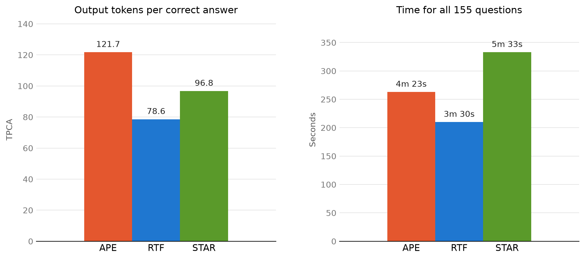
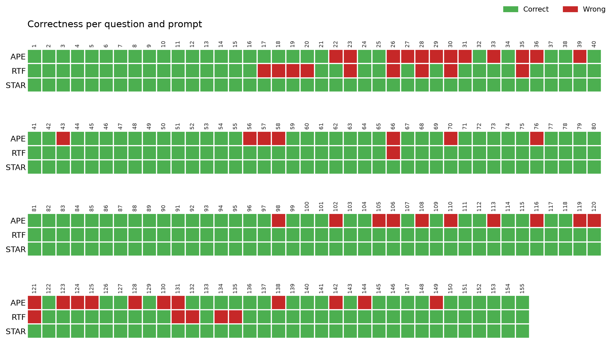
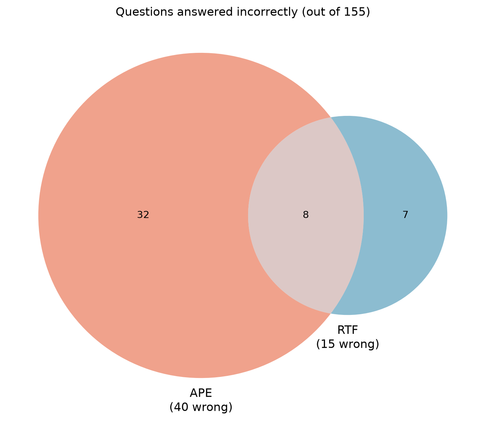

# Task 4 – Detailed Prompt Comparison

All three prompts were run with GitHub Copilot using the GPT-5.6 Luna model, each in a new session, on the same set of 155 questions about a restaurant database.

## 1. Overview

Firstly let's put all the information we have into one table

| Method | Time | Correct Answers | Accuracy | Tokens | TPCA |
| :---: | :---: | :---: | :---: | :---: | :---: |
| APE | 4m 23s | 115 | 74.19% | 14K | 121.74 |
| RTF | 3m 30s | 140 | 90.32% | 11K | 78.57 |
| STAR | 5m 33s | 155 | 100% | 15K | 96.77 |

 

STAR is the most accurate, but also the slowest. RTF is the fastest and the most efficient with its tokens (lowest TPCA), but it made 15 mistakes. APE is the worst in accuracy and TPCA, and sits in the middle in time.

## 2. Which questions were answered wrong

The heatmap shows every question (numbered by its position in the dataset) and whether each prompt answered it correctly.

The Venn diagram shows how the mistakes overlap.

- STAR made no mistakes.
- APE made 40 mistakes, RTF made 15. Only 8 questions were wrong for both, so the two prompts mostly fail on different questions.
- RTF got 32 questions right that APE got wrong, while APE got only 7 right that RTF got wrong.

### Errors by question type

| Question type | Count | APE wrong | RTF wrong | STAR wrong |
| :--- | :---: | :---: | :---: | :---: |
| Rating | 69 | 30 | 9 | 0 |
| Street | 46 | 7 | 1 | 0 |
| Best place | 19 | 2 | 0 | 0 |
| Location only | 15 | 0 | 4 | 0 |
| Named restaurant | 5 | 0 | 0 | 0 |
| Off-topic | 1 | 1 | 1 | 0 |

Most mistakes are in the rating questions: APE got 30 of 69 wrong. These questions require the model to apply the rating condition correctly and return the right columns, which leaves more room for small differences from the expected result. The single off-topic question ("What is the lifes greates illusion?") was answered correctly only by STAR.

### Distracting text

44 of the questions contain irrelevant text. Interestingly, however, this did not cause the errors. APE scored 72.1% on clean questions and 79.5% on questions with distractions, and RTF scored 89.2% and 93.2% respectively. The model ignored the extra text well with all three prompts.

## 3. Why the prompts differ

### The prompts

**STAR** (Situation, Task, Action, Result) gives the model the most context: it describes the situation, the task, how to approach it and what the result should look like. This leads to more specific answers, which explains the 100% accuracy, but also the longer time and more tokens.

**RTF** (Role, Task, Format) is short and clearly defines the output format. The model knows exactly what to produce, so it answers quickly and with few tokens, but with less context it makes more mistakes on the harder questions.

**APE** (Action, Purpose, Expectation) describes what to do and why, but gives the least guidance on the exact output. The model has to guess more, which shows in the rating questions, where the exact conditions and returned columns matter.

### The model

GPT-5.6 Luna is a lightweight model. Smaller models usually depend more on how the prompt is written, which is likely why the framework made such a big difference (74% to 100%). A stronger model would probably narrow the gap.

## 4. Conclusion

All differences in accuracy between the prompts are statistically significant. STAR is the best choice when correctness matters most, as it answered every question correctly. RTF is the best choice when speed and cost matter, as it was the fastest and most token-efficient while still reaching 90% accuracy. APE was the worst on both accuracy and efficiency. The main limitation of this comparison is that each prompt was run only once, so the time and token results should be confirmed with repeated runs. More accuracy could likely be gained by allowing the model to redo the answers more times, however that creates more time and token cost.