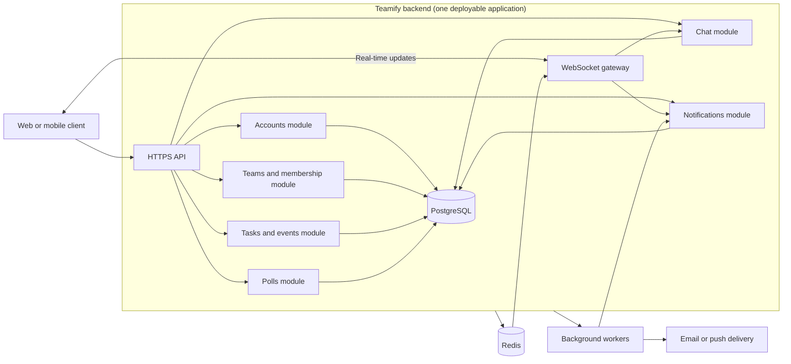

# ADR: Teamify Architecture

- **Status:** Accepted
- **Date:** 2026-10-29

## Context

Teamify manages personal and team agendas, teams, shared events, chat, polls,
and notifications.

The main architecture needs are:

- real-time chat and notifications;
- shared data with multiple users editing it;
- authentication, roles, and team administration;
- privacy and account deletion; and
- reliable updates to agendas, events, and polls.

The requirements do not yet define load, latency, availability, retention, or
scaling targets. We assume a small-to-medium system and a team that is not
already running Kubernetes or several services.

## Options considered

### Option 1: Modular monolith

One backend contains separate modules for accounts, teams, tasks and events,
chat, polls, and notifications. The client uses HTTPS and WebSockets.
PostgreSQL stores application data. Redis supports sessions, presence, and
pub/sub. Workers handle background work and notification retries.

### Option 2: Event-driven services

Separate services handle identity, teams, tasks and events, chat, polls, and
notifications. An API gateway serves the client. Services use APIs and a
broker such as Kafka or RabbitMQ. Each service owns its data store.

### Option 3: Managed serverless or backend-as-a-service

Managed authentication, databases, real-time updates, functions, queues, and
storage provide most of the platform. Examples include Supabase and Firebase.

## Comparison

| Criterion | Option 1: Modular monolith | Option 2: Event-driven services | Option 3: Managed serverless/BaaS |
|---|---|---|---|
| Development speed | High: one codebase and simple local setup | Low: many services, contracts, and deployments | Very high: many features are managed |
| Complexity | Low to medium | High: network calls, eventual consistency, and more operations | Medium: simple infrastructure but provider-specific code |
| Scaling | Good for small-to-medium workloads; limited independent scaling | Very high: services scale independently | High, but limited by provider quotas and service limits |
| Real-time support | Good: controlled WebSockets, Redis, and workers | Very good: dedicated gateways and brokers | Very good: managed real-time updates |
| Cost | Predictable infrastructure cost; the team runs it | Highest infrastructure and operations cost | Often low at first; usage costs can be hard to predict |
| Control over data | Highest: the team controls storage, access, retention, and deletion | High, but with more infrastructure to manage | Lowest: subject to provider policies, features, and pricing |

## Decision

Choose **Option 1: a modular monolith** with directly controlled
infrastructure.

The system will use:

- separate modules for accounts, teams, tasks and events, chat, polls, and
  notifications;
- PostgreSQL for application data;
- Redis for sessions, presence, short-lived state, and pub/sub;
- WebSockets for chat and live updates;
- background workers for retries and offline notifications; and
- an HTTPS API for the client.

Each module owns its rules and data access. Modules communicate through clear
interfaces and domain events, not direct access to another module's tables.
WebSockets, queues, storage, and authentication sit behind replaceable
interfaces.

### Technology stack

- **Backend:** TypeScript with NestJS. We chose NestJS over Spring Boot because
  the team's TypeScript choice lets us use one language across the backend and
  React client.
- **Client:** React for the web application; React Native may support a future
  mobile client.
- **Data and infrastructure:** PostgreSQL, Redis, WebSockets, and background
  workers.

## Chosen architecture

## Reasons

The modular monolith is fast to build and easy to test and operate. It gives
related features strong database transactions and supports real-time behavior
without the cost of a distributed system.

We are not choosing services first because current requirements do not justify
their extra deployments, network failures, distributed transactions, broker
operations, and harder testing. Early service boundaries could also be wrong
while the domain is still being clarified.

We are not choosing a managed platform because the team prefers direct control
over login, user data, chat, and notifications. This is a team preference and
planning assumption, not a stated product requirement. Provider lock-in,
uncertain pricing, and less control over data handling are not acceptable for
this decision. We can reconsider this option if fast product validation
becomes more important and we have a suitable export and migration plan.

## Consequences

### Benefits

- The system is easier to build, test, deploy, and debug.
- Related changes can use strong database transactions.
- The team controls data, infrastructure, backups, and recovery.
- Clear module boundaries leave a path to extract chat or notifications later.

### Costs and risks

- All modules share one deployment, so one failure can affect the whole
  backend.
- Modules cannot scale independently at first.
- WebSocket scaling needs careful design.
- The team must run monitoring, security, backups, availability, and recovery.
- Extracting a module later will require contract and data-migration work.

Concrete signals for reconsidering this decision are:

- measured load or WebSocket volume breaks agreed latency or availability
  targets; these targets still need to be defined;
- chat or notifications need separate scaling or fault isolation;
- releases are often blocked because unrelated modules must ship together;
- separate teams need separate ownership and release schedules; or
- measured cost or incident impact shows that extraction would be worth its
  added complexity.

## Assumptions and open questions

### Assumptions

- Teamify starts at small-to-medium scale.
- No current requirement calls for Kubernetes or separate deployments.
- PostgreSQL and Redis meet the initial data and real-time needs.
- The team can run the infrastructure and provide monitoring, backups, and
  recovery.
- The first client target is the web; mobile is a later option.

### Open questions

- What load, latency, availability, retention, and recovery targets should we
  set?
- How should tasks, events, invitations, membership, and administrator roles
  work?
- What delivery guarantees, channels, preferences, and offline behavior do
  chat and notifications need?
- What are the rules for poll anonymity, deadlines, changed votes, and result
  visibility?
- What rules apply to account deletion, shared content, audit logs, security,
  and conflicting edits?
