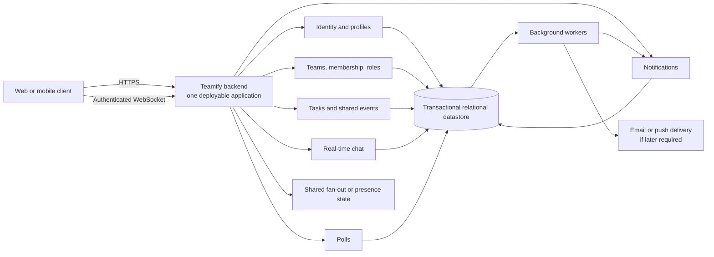

# ADR-001: Use a modular monolith for Teamify

- **Status:** Accepted
- **Date:** 2026-10-29

## Context

Teamify combines personal task management with team collaboration. It must
support accounts, personal tasks, teams and roles, shared events, invitations,
real-time group chat, polls, agendas, and notifications. Account deletion and
role-based access also affect shared data.

The architecture-driving requirements are:

- real-time chat and notifications;
- coordinated authorization for team membership and administrator actions;
- consistent updates to shared events, invitations, polls, and memberships;
- secure account, password-reset, session, and deletion workflows;
- durable records and recovery of notifications or messages after reconnect.

The requirements do not define scale, latency, availability, recovery,
retention, supported clients, deployment ownership, or a need for independent
release schedules. Those unknowns may require a later review.

## Options considered

### Option A: Modular monolith with real-time delivery

One deployable backend contains explicit modules for identity, teams,
planning, chat, polls, and notifications. It provides request APIs and a
WebSocket endpoint. A relational database is the transactional system of
record. Background workers handle retries, notification delivery,
password-reset messages, and account cleanup. A shared pub/sub or presence
component may be added when multiple backend instances require it.

### Option B: Independently deployed domain services

Separate services own identity, collaboration, planning, chat, polls, and
notifications. An API gateway and real-time gateway serve clients, while a
durable broker propagates domain events. Each service owns its data.

### Option C: Managed serverless or backend-as-a-service platform

Managed identity, database, functions, and real-time subscriptions provide
most infrastructure. Functions implement domain operations and background
work, while provider rules and application checks enforce access.

## Comparison

| Criterion | Modular monolith | Domain services | Managed platform |
|---|---|---|---|
| Initial delivery | Fastest route to a coherent first release; shared code and transactions simplify implementation. | Requires service boundaries, contracts, broker workflows, and multiple environments early. | Fast when provider primitives match; custom behavior can remove the advantage. |
| Shared-data consistency | Direct transactions fit membership, permissions, events, invitations, and notifications. | Cross-service operations require eventual-consistency workflows and reconciliation. | Depends on provider transaction and trigger semantics. |
| Real-time behavior | WebSockets, durable records, reconnect cursors, and shared fan-out can meet the requirement with deliberate scaling. | Gateways can scale independently, but ordering and delivery across services are harder. | Subscriptions reduce infrastructure work, but semantics and recovery are provider-specific. |
| Operations | Fewest components; module boundaries and background jobs need discipline. | Requires tracing, broker monitoring, contract tests, deployment automation, and distributed incident response. | Less infrastructure operation, but provider limits and recovery can be opaque. |
| Control and changeability | Central policies and data; internal modules preserve a path to extraction. | Strong independent releases, but expensive contracts and distributed workflows. | Fast early changes, but provider coupling makes unusual behavior and migration costly. |

## Decision

Use **Option A: a modular monolith with real-time delivery**.

The backend will be one deployable application with enforced internal
boundaries for:

- identity and profiles;
- teams, membership, and roles;
- personal tasks and shared events;
- chat;
- polls;
- notifications.

The system should use a transactional relational datastore for durable domain
data. Real-time clients should connect through an authenticated WebSocket
endpoint. Notifications and other work that may be retried should be persisted
before delivery or represented by a transactional outbox. Workers should
process retries idempotently and expose failures. Reconnecting clients should
be able to request data missed since a cursor or last-known notification.

These are architectural capabilities, not commitments to particular vendors or
frameworks. Specific technology choices remain open until scale, hosting, and
team constraints are known.

## Reasons for rejecting the alternatives

Option B was rejected for now because the current requirements do not justify
the operational and consistency costs of distributed services. It should be
reconsidered if independent scaling, fault isolation, separate team ownership,
or independent release schedules become concrete requirements.

Option C was rejected for now because the requirements leave important
authorization, shared-data, deletion, and real-time semantics open. A managed
platform may still be useful if its guarantees match those decisions and
provider coupling is an accepted preference.

## Consequences

### Benefits

- Shared membership, permissions, events, invitations, and notifications can
  use direct transactions.
- Development, local testing, deployment, and debugging are simpler than with
  distributed services.
- Internal module boundaries provide a possible path to extract a service
  later.
- Durable notifications and reconnect handling can support real-time behavior
  without requiring a distributed domain immediately.

### Costs and risks

- A deployment or resource incident can affect all capabilities.
- Chat fan-out and WebSocket connection state need careful design when the
  backend has multiple instances.
- Background retries, duplicate delivery, dead letters, and reconciliation
  still require explicit implementation.
- Module boundaries can erode, and database migrations and releases remain
  partly coupled.
- Account deletion and shared-content retention rules remain unresolved.

## Reconsideration signals

Revisit this decision if:

- measured or agreed latency, availability, or scale targets cannot be met by
  the monolith;
- chat, notifications, or another module needs materially different and
  independent scaling;
- one module's failures or deployments repeatedly affect unrelated features;
- separate teams require independent ownership and release schedules;
- operational cost or incident impact from the shared deployment becomes
  unacceptable;
- a managed platform's guarantees become a better fit for the finalized
  requirements.

The relevant targets and acceptance criteria have not yet been defined, so no
numeric threshold is inferred here.

## Assumptions and open questions

- The first client platform and hosting model are not specified.
- Task and event fields, recurrence, time zones, and their domain distinction
  need definition.
- Team invitations, last-administrator rules, and membership permissions need
  definition.
- Poll anonymity, deadlines, result visibility, and vote changes need
  definition.
- Chat history, read status, presence, moderation, and offline behavior need
  definition.
- Notification channels, preferences, retention, and delivery guarantees need
  definition.
- Password, session, backup, deletion, anonymization, and shared-content
  retention policies need definition.
- Concurrent-edit and conflict-resolution behavior needs definition.
